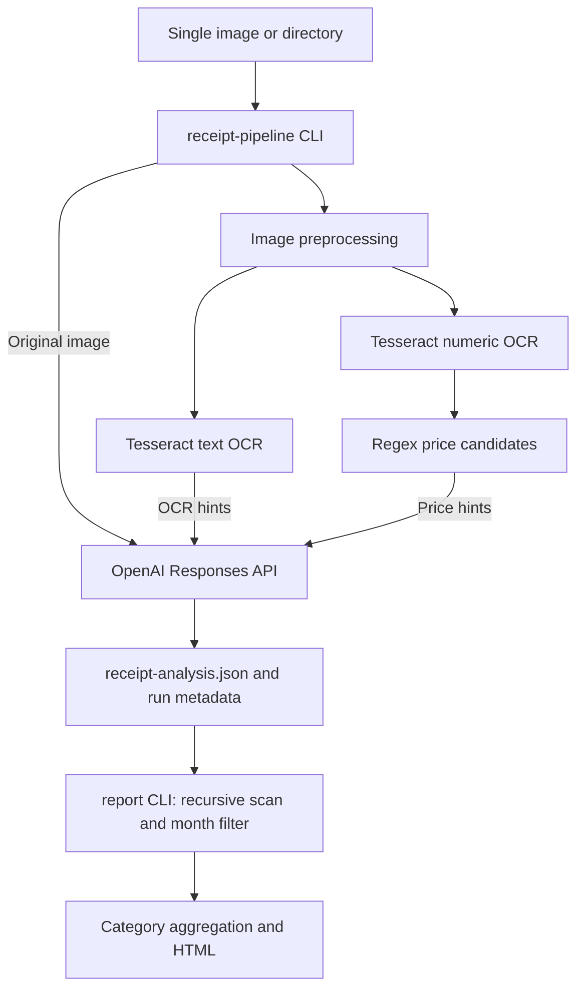

# Expense Tracker

Go command-line tools that turn supermarket receipt photos into categorized JSON and monthly HTML spending reports. The current analysis targets Colombian pesos (COP), uses Tesseract locally, and sends receipt images plus OCR hints to the OpenAI Responses API.

## Features

- Preprocess receipt photos with automatic orientation, grayscale, enlargement, sharpening and thresholding.
- Run text and numeric OCR, retaining price hints and intermediate artifacts.
- Extract product names, English translations, quantities, amounts and categories using image-based structured output.
- Process a single JPEG/PNG or a directory of images, continuing after individual failures.
- Generate a monthly HTML report with category totals, percentages and bars.

## Architecture



## Setup

Use Go compatible with the module's `go 1.25.5` directive, a C/C++ build toolchain for CGO, and Tesseract/Leptonica development libraries. On Debian/Ubuntu:

```bash
sudo apt update
sudo apt install -y build-essential tesseract-ocr tesseract-ocr-eng tesseract-ocr-spa libtesseract-dev libleptonica-dev
cp cfg/example.config.json cfg/config.json
export OPENAI_API_KEY="your-api-key"
```

Run commands from the repository root. The example configuration is an empty JSON object; configuration currently covers logging. The extraction model (`gpt-5-mini`) and low reasoning effort are set in source, not in the configuration file. Dependencies and live API compatibility have not been verified by this documentation review.

## Process receipts

Replace the input path with your own image or directory:

```bash
go run ./src/cmd/receipt-pipeline   -config ./cfg/config.json   -image ./receipts/   -out ./out   -language "eng+spa"
```

Directory input includes `.jpg`, `.jpeg` and `.png` files directly inside that directory, sorted by filename; subdirectories are not scanned. Add `-price-difference` to skip saving analyses when the model reports a mismatch between item sums and the receipt total. This is a model-reported check, not independent arithmetic validation.

Each run writes under `out/<lowercase-month>-<year>/<timestamp>/`:

```text
orig.<extension>
clean.png
ocr.txt
numbers-ocr.txt
prices.json
receipt-analysis.json
```

Failed runs may contain only intermediate files. The saved analysis includes token usage, model and response information, and processing timestamps.

## Generate a report

```bash
go run ./src/cmd/report   -out ./out   -year 2026   -month 1   -tz America/Bogota   -o ./tmp/report-2026-01.html
```

Open the generated HTML file in a browser. The output parent directory must exist; `tmp/` is included in this repository. The report scans recursively for files ending in `receipt-analysis.json`. `-max-rows` defaults to 100 and groups excess categories into Other; `-title` overrides the heading.

Date selection prefers `receipt_datetime`, then `receipt_date`, then analysis start time. The current extraction schema produces neither receipt date field, so ordinary pipeline results are grouped by processing month. The headline total prefers a positive printed receipt total, then a positive computed total, then summed line amounts. Categories always aggregate item line totals.

## Limitations and status

Review extracted amounts before relying on a report. Currency is COP-specific, repeated processing can count the same purchase multiple times, and fractional monetary values accepted by extraction cannot be decoded by the report's integer amount fields. Reports may have category sums that differ from the headline total.

Local storage does not mean offline analysis: receipt images and OCR text are transmitted to OpenAI, and requests enable API storage and background processing. Logs can include receipt content. Protect input files, output artifacts and logs.

Separate `ocr` and `analyze-receipt` commands are also present; the latter currently assumes `orig.jpg`. Generic email/example commands are separate utilities. The included Dockerfile is a placeholder and does not build a receipt command as written. No automated tests or CI configuration are included. Development is currently paused. Deployment status is unconfirmed.
