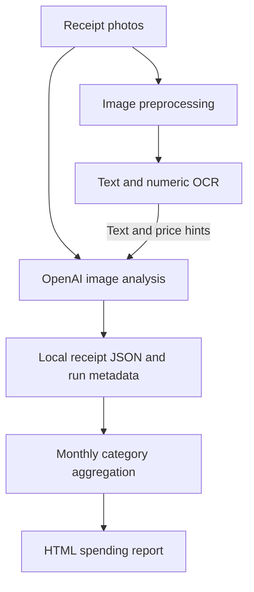

# Expense Tracker

## Overview

Expense Tracker is a Go command-line tool for turning supermarket receipt photos into categorized purchase data and monthly HTML spending reports. It targets Colombian peso receipts, with English and Spanish OCR enabled by default. Processing artifacts are stored locally; receipt images and extracted text are sent to OpenAI for analysis.

## My Contributions

The repository demonstrates implementation of image preprocessing, separate text and numeric OCR passes, price-hint extraction, and schema-constrained receipt analysis. A combined command processes individual photos or a directory of images, saves analysis beside its source artifacts, and continues after individual receipt failures. A separate report command aggregates purchases by category and renders a self-contained HTML report.

These contributions concern the receipt-specific implementation developed after the initial scaffold. The origin of general-purpose support packages has not been established.

## Architecture

The image is the model's primary source; OCR and numeric price candidates provide supporting hints. JSON Schema constrains the returned structure. Saved metadata includes model information, token usage, response identifiers, and processing times. No database or hosted application is required by this workflow.

## Technical Challenges

Receipt photos contain ambiguous characters and loosely aligned price columns. The preprocessing pipeline applies image orientation, grayscale conversion, enlargement, sharpening, contrast adjustment, and thresholding before OCR. A separate numeric pass supplies candidate prices to the image-based model. These are implemented approaches; no accuracy benchmark establishes their improvement.

The analysis prompt asks the model to compare item sums with the printed total. An optional flag rejects analyses with a model-reported mismatch. This check is not independently recalculated in Go.

## Results and Current State

The code implements photo-to-JSON processing and monthly HTML reports with category amounts, percentages, and bars. A report screenshot is committed. Automated tests, extraction accuracy measurements, deployment evidence, and usage metrics are absent from the inspected repository.

Generated analyses omit purchase dates, so reports normally group receipts by processing time. The implementation assumes COP and requires review of model-extracted amounts before financial use. Development is currently paused, as confirmed by the repository owner.

## Development History

Observed Git activity runs from November 26, 2025 to January 30, 2026. Receipt OCR and structured text analysis were introduced in November; December added numeric price hints, image input, and reporting. January added the combined batch pipeline, automatic image orientation, and further category and report refinements. These dates describe repository activity, not confirmed project start or completion dates.
